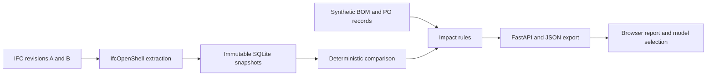

# Pilot workplan and prompt analysis

Date: November 9, 2026. Status: proposed implementation, not completed work.

## Assessment

Proceed with a constrained pilot. The prompt identifies a consequential workflow and a visible outcome: an engineering revision invalidates an existing procurement assumption, and software shows why. Library reuse and deterministic comparison are appropriate choices for the two-day limit.

The prompt is a strong concept brief but leaves several implementation decisions open:

| Gap | Pilot decision |
| --- | --- |
| “Two days” has no effort budget | Two calendar days with 20 focused development hours total, including setup and verification. Record overruns. |
| Arbitrary IFC imports invite geometry and schema complexity | Support IFC4, straight prismatic beams and columns, a constant rectangular profile, and explicit material specifications. Report unsupported representations. |
| Downloadable models may lack suitable geometry, metadata, or redistribution rights | Generate a small original IFC fixture with IfcOpenShell and publish its source and license. A licensed external sample is a stretch validation case. This deliberately changes the prompt's initial imported-model proposal. |
| A length property can disagree with the modeled shape | Compute supported quantities from the representation; retain authored quantities separately and flag disagreement. |
| GlobalId fallback matching can silently attach the wrong PO | Use unique IDs first; permit only a documented unique tag/class/container fallback. Expose the matching method and uncertainty. |
| “Manufacturing readiness” suggests more knowledge than the fixture contains | Report synthetic review states and their triggering rules. Do not infer actual production approval. |
| A 3D viewer can consume the entire second day | Test IFC loading and selection during the first two hours; cap later viewer integration at two hours. |

The current [Fluidstack role](https://fluidstack.com/jobs/1f191895-fcfd-4cfb-8d4f-2cc3904e3cf2) includes BOM/procurement consistency, revision traceability, Python or TypeScript, LLM/document workflows, and operator adoption. This pilot demonstrates only part of that scope. IFC itself is our chosen demonstration format; the posting does not establish it as Fluidstack's production format.

## Scope and demonstration contract

Build a local application for an engineer or procurement reviewer. Inputs are two IFC revisions and synthetic procurement JSON. Outputs are component changes, affected BOM/PO lines, review reasons, and exportable evidence.

Use roughly 12–20 members in a small equipment-support frame. Baseline A contains BEAM-014, length 4.000 m, rectangular cross-section 0.100 × 0.200 m, and illustrative material specification Grade A. Revision B preserves its GlobalId, changes length to 4.500 m, and changes specification to Grade B.

Expected quantities: length +0.500 m; modeled volume 0.080 → 0.090 m³, a +0.010 m³ change. Piece count remains one. Do not equate a longer member with an additional purchased piece, or infer weight without a declared density.

Use one directly affected BOM line and one linked PO line in the core fixture. PO-1042 retains its original specification and cut length. Both mismatch reasons belong to that one PO line; counts deduplicate records. A second affected BOM line requires an explicit additional dependency, not an invented multiplier.

The report must show baseline and revised values, units, source element, revision identity, match method, BOM line, PO line, rule identifier, and recommended review action. No automatic PO modification.

Exclude arbitrary CAD formats, general mesh equivalence, structural certification, live ERP connections, drawing/PDF extraction, authentication, cloud deployment, and LLM explanations from the two-day commitment. Document consistency is limited to the supplied synthetic records.

## Architecture and data contract

Use Python 3.12, IfcOpenShell, Python's built-in SQLite driver, Pydantic, FastAPI, pytest, and a Vite/TypeScript interface using That Open. Bonsai is the authoring and independent inspection tool. Avoid an ORM or graph database for this size of fixture.

Proposed canonical entities:

| Entity | Essential fields |
| --- | --- |
| Revision | ID, source SHA-256, file name, IFC schema, units, extractor/rule versions |
| Component snapshot | Internal row ID, revision ID, GlobalId, STEP ID, class, tag, container, type/material references, normalized geometry, quantities, source paths |
| Match | A/B snapshot IDs, method, confidence category, ambiguity reason |
| BOM revision and line | Baseline/revised BOM ID, stable line ID, linked component identity, item spec, quantity, unit |
| PO line | PO/line IDs, referenced baseline BOM line, ordered specification, cut length, count, illustrative status |
| Change and impact | A/B evidence, field, values, rule/version, affected record IDs, review state |

STEP IDs locate records within a particular file; never use them as cross-export identity. Keep original files and their hashes. Store source units alongside normalized SI values. Preserve source records rather than overwriting baseline BOM/PO data with revised values.

Comparison rules:

1. Validate identifiers and required fields before matching. Duplicate IDs produce diagnostics; do not silently drop rows using an ID-keyed dictionary.
2. Match unique GlobalIds across the same project. Where an ID is absent or regenerated, a unique `(class, tag, spatial container)` may yield a lower-confidence candidate. Ambiguity remains unresolved and cannot produce a definitive procurement conclusion.
3. Within controlled exports with reliable identity, classify unmatched components as added or removed. If identity continuity is broken, show unresolved candidates rather than confidently presenting a replacement as two independent events.
4. Canonicalize sorted property/material records and normalize units. Ignore header timestamps, entity ordering, and serialization IDs. Compare geometry in local coordinates and placement separately.
5. For the fixture's supported profile/extrusion, compute length and volume from representation parameters. Do not use world-axis bounding-box length or raw tessellation hashes as the quantity definition. Unsupported geometry has an explicit unavailable quantity.
6. Record comparison tolerances, initially 0.1 mm for lengths and 1e-6 m³ for volume, with boundary tests. These are demo settings, not engineering acceptance standards.
7. Detect effective type-level material changes as well as occurrence-level changes. Mark absent or conflicting specifications as unknown.
8. Apply explicit rules: length/specification mismatch → review required; removed ordered item → cancellation review; new unlinked item → sourcing review; missing evidence/ambiguous match → undetermined. “No discrepancy detected” applies only to evaluated fields and rules.

Suggested API: import revisions, compare two revision IDs, fetch comparison/impact details, download report JSON. Validate upload size/type and use local storage. The browser maps each selected element to `(revision ID, GlobalId)`; viewer-local numeric IDs must not leak into matching logic. Serve version-matched WASM and worker assets locally and prove they load in the production build.

## Two-day schedule

| Time | Work | Required exit evidence |
| --- | --- | --- |
| Day 1, hours 0–2 | Resolve dependencies; generate one beam; open it in Bonsai and the browser; validate viewer selection mapping | IFC import and geometry smoke checks; recorded package versions; viewer/authoring risks known |
| Day 1, hours 2–4 | Build fixture generator, revisions, immutable SQLite schema, unit/material extraction | Inspectable baseline and revised records with source references |
| Day 1, hours 4–7 | Implement ID validation, matching, semantic diff, quantity calculations | Passing unchanged, reordered, length, material, and identity tests |
| Day 1, hours 7–10 | Add baseline/revised BOMs, synthetic PO data, impact rules, JSON report | Headless audit proves BEAM-014 → BOM line → PO-1042 with correct quantities and deduplicated counts |
| Day 2, hours 0–2 | FastAPI endpoints, validation and integration test | End-to-end import → comparison → report through API |
| Day 2, hours 2–4 | Report table, selection, changed-member highlighting | Clicking a discrepancy shows the correct model element and evidence |
| Day 2, hours 4–6 | Bonsai revision round trip, edge cases, negative controls | Saved IFC revision drives the result; no hardcoded change report |
| Day 2, hours 6–8 | Reproduction script, locked dependencies, documentation, clean-directory run | A reviewer follows documented prerequisites and one demo command successfully |
| Day 2, hours 8–10 | Fix release blockers, record 90-second demo, write case study and retrospective | Evidence bundle and measured pilot outcome |

The project owner approves scope and reviews evidence. An implementation agent may produce code/tests within these contracts; the owner independently checks the Bonsai edit and report. Log assistance, decisions, and corrections. Parallel agents are not required for this plan.

If the engine fails its Day 1 exit gate, spend Day 2 on correctness and report the full pilot incomplete. If viewer integration exceeds its budget, deliver a table/JSON audit with Bonsai inspection as a **reduced demonstration**; do not claim the original browser-highlighting acceptance criterion passed. If authoring cannot be completed, use the generated revision for engine verification and record that the Bonsai demonstration remains incomplete.

## Acceptance checklist

| Test | Expected evidence |
| --- | --- |
| Same model and harmless re-export | No semantic changes or procurement alerts |
| IFC entities and properties reordered | Identical canonical results |
| 4.000 → 4.500 m beam | +0.500 m length, +0.010 m³ volume, unchanged count |
| Millimeters versus meters | Equivalent canonical quantities and no false change |
| Member placement changed | Placement change is separate from length/specification change |
| Material changed on occurrence or inherited type | Affected linked PO line flagged with before/after source evidence |
| Two reasons affect one PO line | Two reasons, one affected PO line |
| Addition and deletion with reliable IDs | Correct separate categories and corresponding sourcing/cancellation reviews |
| Missing, duplicated, or regenerated IDs | Explicit diagnostics or documented fallback; no invented certainty |
| Missing quantity/spec or unsupported shape | Unknown status; no invented zero, weight, or approval |
| Stale authored quantity | Geometry-derived result and inconsistency diagnostic |
| Tolerance boundaries | Below/at/above tolerance behaves as documented |
| Report rerun | Stable sorted semantic output, apart from declared run metadata |
| UI/API integration | Selected discrepancy opens the correct revision element and downloadable evidence |
| Clean reproduction | Documented setup plus `make demo` works; command must be implemented before release |

All cases are release requirements unless explicitly marked as an incomplete scope item. Tests should use generated deterministic fixtures and independently asserted expected values.

## Repository and release artifacts

Implement under `pilots/fluidstack-change-auditor/` so this workspace can hold later pilots. Use `engine/{ingest,canonical,diff,impact}`, `api`, `web`, `tests`, `fixtures`, `scripts`, and `docs`. Include a fixture manifest, provenance/license notes, expected audit JSON, lockfiles, architecture, job mapping, demo script, test results, and limitations.

`make demo` is a planned deliverable: restore locked dependencies, generate fixtures, run the audit, build the frontend, and serve the local application. It should work after documented Python/Node prerequisites; Bonsai is needed to author a new revision, not to replay committed fixtures. Publishing and sending a job application are later user actions.

## Implementation prompt

> Build the planned OpenBIM Engineering Change Auditor within a two-day, 20-hour development budget. Start with the constrained IFC4 fixture and deterministic acceptance cases in this workplan. Preserve revision provenance and units; compute quantities only for supported geometry; never silently match ambiguous identities. Produce immutable baseline/revised BOM records and synthetic procurement discrepancies with complete evidence. Validate the engine before presentation work. Reuse IfcOpenShell, SQLite, FastAPI, and That Open. Timebox viewer work and disclose any fallback as reduced scope. Finish with locked dependencies, a reproducible demo command, regression results, and a short demonstration. Keep measured outcomes separate from goals. Do not use employer materials, invent production adoption, or add LLM calls to the comparison engine.

Implementation update: a working local pilot now exists. See the [measured validation results](../pilots/fluidstack-change-auditor/docs/validation.md). November 10 update: the [Bonsai authoring round trip](../pilots/fluidstack-change-auditor/docs/bonsai-validation.md) is verified with agent assistance and an 87-second recording. The owner accepted the independent review on November 10, closing the authoring gate for the disclosed agent-assisted workflow; other planned outcomes above should not be read as achieved claims.
