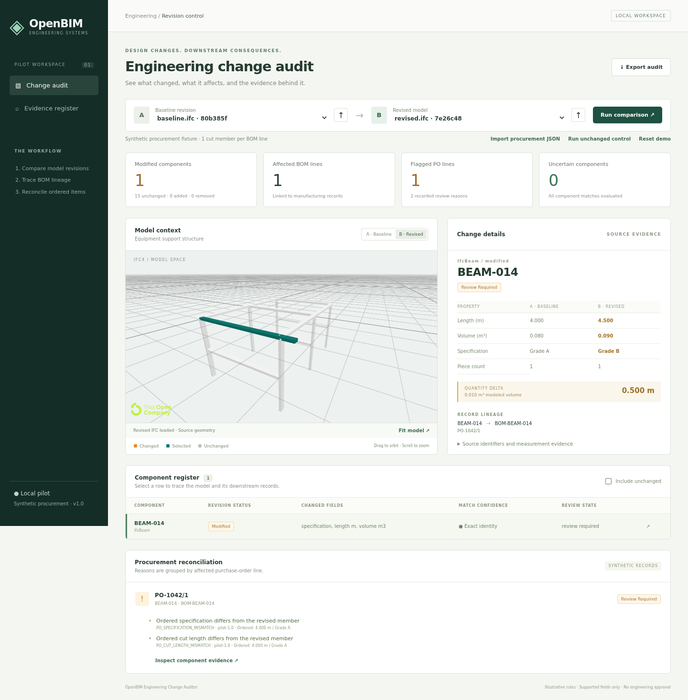

# OpenBIM Engineering Change Auditor

A local IFC revision auditor that traces supported geometry and material changes through synthetic BOM and purchase-order records, with deterministic source evidence.



**Status:** working engine, API, and browser viewer; generated-fixture workflow verified. A manual Bonsai edit/save round trip remains unverified. Independent portfolio project, with no Fluidstack affiliation or employer materials.

## Run locally

Prerequisites: Python 3.12, uv, Node 22.12+, npm, and Make. Use the lockfiles: Vite 7.3.8 and web-ifc 0.0.77 are intentional compatibility pins.

```bash
cd '/home/big/Documents/GitHub/Application Portfolio Pipeline/pilots/fluidstack-change-auditor'
make demo
```

Open **http://127.0.0.1:8000**. This restores dependencies, generates original IFC fixtures, writes `data/audit.json`, builds the interface, and starts FastAPI. Initial installation needs internet access; runtime uses local assets. Stop with Ctrl+C.

On an already prepared checkout, use `make serve`. After frontend changes, run `make build` first. API documentation is at `/docs`.

## Try the workflow

1. Inspect BEAM-014: length 4.000 → 4.500 m, volume 0.080 → 0.090 m³, Grade A → Grade B. Piece count stays one.
2. Follow its BOM link to PO-1042/1. Two discrepancy reasons affect one order line. The auditor does not modify procurement.
3. Switch baseline/revised views, select a component in the table or model, and expand its source evidence.
4. Run the unchanged control: no changes or discrepancies.
5. Import a revised `.ifc` using the arrow beside its selector, then run comparison. Preserve the same project and component identities where possible.
6. Export the JSON audit or download original IFCs from Evidence register. Import synthetic procurement JSON following `fixtures/procurement.json` when using a different baseline.

Imported inputs do not silently replace the last-run report; run comparison to update it.

## Verification and headless use

```bash
make audit
make test
make build
uv run --locked python -m scripts.audit --help
```

Browser tests require `make serve` in another terminal:

```bash
cd web
npx playwright install chromium
npm run test:e2e
```

On this machine, reuse the temporary browser with `PLAYWRIGHT_BROWSERS_PATH=/tmp/portfolio-playwright npm run test:e2e`. For development, run the API plus `npm --prefix web run dev`; Vite proxies `/api` to port 8000.

## Evidence

- [Architecture and supported scope](docs/architecture.md)
- [Job-to-evidence mapping](docs/job-requirements.md)
- [Validation results and limitations](docs/validation.md)
- [Complete example audit](docs/example-audit.json)
- [Demo script and remaining authoring check](docs/demo-script.md)
- [90-second browser walkthrough](docs/artifacts/browser-demo.webm) — actual scripted browser interactions with pre-generated IFC revisions; no live Bonsai edit.
- [Fixture provenance](fixtures/manifest.json)

## Supported scope

IFC4, one project, rectangular `IfcExtrudedAreaSolid` beams/columns, one Body solid, no openings, and explicit length units. Single occurrence/inherited material names stand for illustrative specifications. Compared fields are class, tag/name, container name, effective material, dimensions, modeled volume, profile/solid transforms, and placement. Arbitrary property-set comparison is not implemented.

Missing/unsupported geometry, inconsistent authored quantities, ambiguous materials, and unreliable identity produce uncertainty. Candidate fallback matches never produce definitive PO conclusions. The identity policy assumes controlled exports; arbitrary exporter identity replacement cannot always be reconstructed.

The synthetic BOM has one cut member per line; PO count is one and status is `ordered`. There is no assembly explosion, weight calculation, material equivalence, structural validation, ERP integration, LLM extraction, production-readiness assertion, or operator-adoption claim. Visualization support does not expand audit support.

SQLite contains immutable JSON snapshots/reports and original source BLOBs. This is a local pilot, not a public multi-user upload service.

## Layout

```text
engine/audit.py       IFC normalization, matching, comparison, impact rules
engine/store.py       SQLite snapshots, source files, procurement, reports
api/                 FastAPI validation, endpoints, static serving
scripts/             Original fixture generator and headless audit CLI
fixtures/            IFC4 revisions, procurement, SHA-256 manifest
web/                 TypeScript interface, That Open viewer, browser tests
tests/               Engine/API cases and independent numeric expectations
docs/                Architecture, results, example audit, screenshots, video
```

Vite 8/Rolldown crashed on this machine's CPU; Vite 7.3.8 works. web-ifc 0.0.78 failed real browser conversion; 0.0.77 works. Current That Open packages emit warnings about optional WebGPU exports; this application's verified path uses WebGL. API tests emit an upstream HTTPX deprecation warning. Recheck runtime behavior before upgrading dependencies.
