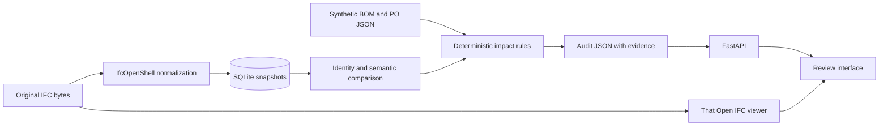

# Architecture and contracts

## Immutable evidence and matching

Revision IDs hash the original IFC bytes. SQLite stores JSON snapshots/reports and source BLOBs; inserts never overwrite an existing revision. Reimporting identical bytes returns the original snapshot. Connections are short-lived and explicitly closed.

Components preserve revision hash, GlobalId, STEP ID, class, tag, container, material references, geometry parameter locations, and supported authored quantities. STEP IDs are within-file evidence locators, never cross-export matching keys.

Unique valid GlobalIds match within the same project. A unique `(class, tag, container GlobalId)` fallback produces only a candidate. Missing/duplicate IDs and ambiguous unmatched sets remain uncertain. No candidate is promoted to a definitive procurement conclusion.

Header timestamps and serialization order do not create semantic changes. Different source bytes still have different source/audit hashes. Identical inputs and rule versions produce identical sorted report JSON.

## Geometry and units

Supported geometry: IFC4 beam/column, one rectangular Body extrusion along local positive Z, positive dimensions, no openings. Mapped/boolean/clipped geometry, oblique extrusion, and other profiles are unsupported. Placement and local solid/profile transforms are compared separately from shape dimensions.

Normalize to metres and cubic metres; volume is width × height × extrusion depth. Length tolerance is 0.0001 m; volume tolerance is 0.000001 m³; rotation-matrix tolerance is 1e-8. Equality at a tolerance is unchanged. These are demo settings, not fabrication criteria.

Supported authored Length/NetVolume/GrossVolume quantities are retained and compared to geometry. A disagreement suppresses definitive PO conclusions. Missing authored quantities do not prevent measurement from supported geometry. A single occurrence or inherited material name is the synthetic specification; ambiguous/absent materials are unknown. Arbitrary property sets are outside the implemented comparison.

## Procurement rules

Pydantic validates finite positive lengths, unique IDs, one BOM line per component, and PO-to-BOM references. Each line represents one cut member and each PO line is `ordered`. Revised BOM lines retain baseline IDs where identity is unambiguous; original baseline and PO values remain intact.

Rules cover specification/cut-length mismatch, baseline BOM inconsistency, profile/placement review, new-member sourcing, removed-item cancellation review, missing lineage, and source/identity uncertainty. Orphan BOM rows produce report-level diagnostics. Affected-record counts deduplicate BOM/PO lines; individual reasons remain inspectable.

Reports include rule version, tolerances, procurement hash, both source hashes, before/after values, and evidence references. No rule edits an order or approves manufacture.

## Browser and API

That Open loads source IFC into Fragments. Local selection IDs resolve to GlobalIds within the displayed revision. Baseline/revised views are separate so removed elements can be inspected. Version-matched WASM/worker files are copied from installed packages and served locally. A viewer failure is visible while the independent report remains usable.

Endpoints cover demo inputs, revision import/source retrieval, procurement import, audit creation/retrieval, and JSON export. IFC uploads are capped at 20 MiB and 2,000 elements. FastAPI serves the built frontend and OpenAPI docs.

Limitations: controlled-export identity assumptions, bounded representation support, JSON-based SQLite persistence, no public-service hardening, no production load/adoption evidence, and no document-extraction or engineering-certification pipeline.
