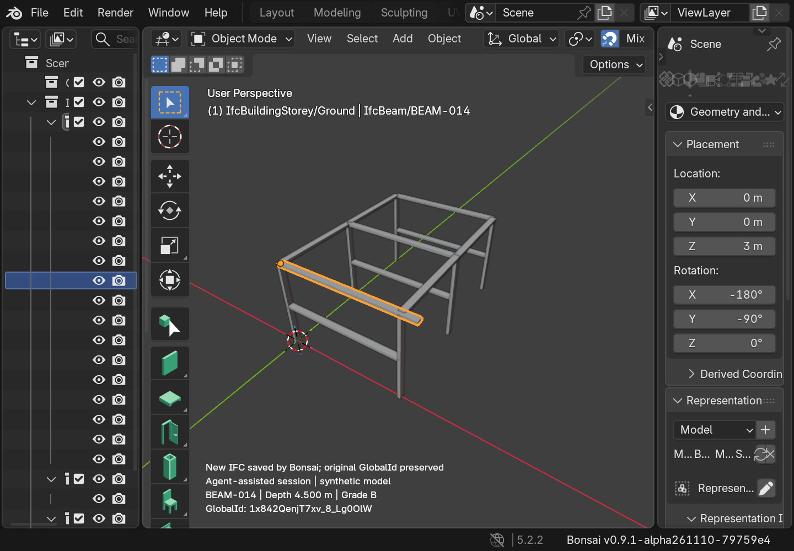
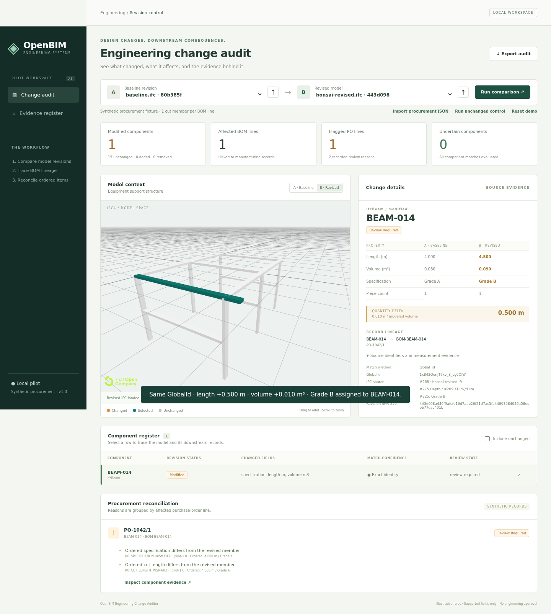

# Bonsai authoring round trip

Verified November 10, 2026. **Technical round trip passed using agent-assisted
Bonsai GUI operations. Independent owner review accepted November 10, 2026.** This is not
evidence of an unaided human mouse-and-keyboard session.

[Watch the 87-second recording](artifacts/bonsai/bonsai-roundtrip.webm), inspect
the [saved IFC](artifacts/bonsai/bonsai-revised.ifc), or read the
[complete audit](artifacts/bonsai/audit.json).

## What was verified

| Check | Result |
| --- | --- |
| Native authoring | Loaded the baseline in Bonsai; changed its extrusion parameter; created and assigned a separate material; saved through `bim.save_project` |
| Identity | BEAM-014 retains GlobalId `1x842QenjT7xv_8_Lg0OlW`; 15 other members remain unchanged |
| Geometry | Rectangular extrusion remains supported; length 4.000 → 4.500 m; volume 0.080 → 0.090 m³ |
| Independent geometry check | IfcOpenShell's geometry kernel measures the saved solid as 0.090 m³ |
| Material | Grade B is assigned to BEAM-014 alone; shared Grade A is not renamed |
| Quantity handling | Old authored quantities are preserved in a negative-control export, then removed from this occurrence before the final save |
| Procurement | One affected BOM line, one flagged PO line, two review reasons, no uncertain components; piece counts stay one |
| Browser | Actual exported IFC renders, A/B switching works, source download matches saved bytes, and browser JSON equals CLI JSON |
| Negative controls | Baseline against itself is clean; the stale-quantity export yields uncertainty and no definitive PO flag |
| Independent owner review | Accepted November 10, 2026 for the disclosed agent-assisted workflow |





## Method and provenance

The run used Blender **5.2.2 LTS** and the official Bonsai
**0.9.1-alpha261110 Linux/Python 3.13** extension. The authoring process bundled
IfcOpenShell **0.9.1a261110**; the auditor retained its existing locked environment.
The [release metadata](artifacts/bonsai/extension-release.json) includes the exact
download URL and SHA-256 checked before installation. The
[session log](artifacts/bonsai/session.json) records actual state after each
operator and hashes the original and saved IFCs. The
[evidence manifest](artifacts/bonsai/manifest.json) hashes the published artifacts.

The baseline was loaded from `fixtures/baseline.ifc`. No revision generator ran
inside the authoring session, and the baseline's bytes were checked unchanged.
`scripts/bonsai_author.py` drives Bonsai's native operators in a visible Blender
window; captions read the current IFC state. `scripts/record_bonsai.py` records
only the window owned by the launched Blender process and closes that process
after capture. The browser recorder imports the resulting file, asserts its
hash, and downloads the preserved source and audit.

The final video concatenates the Blender recording and browser recording at
normal speed. Twelve seconds of Blender startup are omitted. It is an edited
two-session demonstration, not a continuous manual screen recording. Its measured
duration is **87.134 seconds**. Raw captures remain in ignored
`data/bonsai-authoring/`; the edited recording is versioned with its source files.

## Compatibility finding

The stable Bonsai package listed on Blender Extensions excludes Blender 5.1 and
later. The existing Blender 5.2 installation therefore used the official
Python 3.13 alpha build in an isolated profile under `data/bonsai-runtime/`.
See the [official version listing](https://extensions.blender.org/add-ons/bonsai/versions/)
and [official development installation guide](https://docs.bonsaibim.org/studio/guides/development/installation.html).

An attempted capture crashed in Bonsai's extrusion guide after the parameter
update; the [crash trace](artifacts/bonsai/extrusion-gizmo-crash.txt) identifies
`ExtrusionGuidesGizmo.refresh`. Hiding viewport gizmos allowed the recorded run to
complete. The harness includes that workaround. This validates the narrow
recorded workflow, not general alpha-build stability. No engine adapter or
relaxation of the audit's supported geometry rules was needed.

## Replay the evidence without Blender

From the pilot directory:

```bash
uv run --locked python -m pytest -q tests/test_bonsai_roundtrip.py
uv run --locked python -m scripts.audit \
  --revised docs/artifacts/bonsai/bonsai-revised.ifc \
  --output data/bonsai-audit.json
```

With `make serve` running, import the committed `bonsai-revised.ifc` beside the
revision B selector, then run comparison. Import `stale-quantities.ifc` to inspect
the source-data contradiction. Keep baseline procurement selected.

## Recreate the authoring recording on this machine

The isolated profile is already installed. It can be launched for inspection:

```bash
BLENDER_USER_RESOURCES="$PWD/data/bonsai-runtime/profile" \
  LIBGL_ALWAYS_SOFTWARE=1 /snap/blender/current/blender -noaudio
```

To reinstall that exact extension into a new isolated profile, first verify
Blender reports 5.2.2 and then use the pinned package:

```bash
mkdir -p data/bonsai-runtime
curl -fL \
  'https://github.com/IfcOpenShell/IfcOpenShell/releases/download/bonsai-0.9.1-alpha2611100759/bonsai_py313-0.9.1-alpha261110-linux-x64.zip' \
  -o data/bonsai-runtime/bonsai.zip
printf '%s  %s\n' \
  '90516a7bb0ffb23b82aef212d75ef9a6814a5b80be7a5b96fa1d41765105ddf4' \
  'data/bonsai-runtime/bonsai.zip' | sha256sum -c -
BLENDER_USER_RESOURCES="$PWD/data/bonsai-runtime/profile" \
  /snap/blender/current/blender --background -noaudio \
  --command extension install-file --repo user_default --enable \
  "$PWD/data/bonsai-runtime/bonsai.zip"
```

The recorder requires X11, `xdotool`, and `ffmpeg`. Archive an existing
`data/bonsai-authoring/` directory first; the recorder refuses to overwrite it.

```bash
uv run --locked python -m scripts.record_bonsai \
  --blender /snap/blender/current/blender \
  --profile data/bonsai-runtime/profile

# With the auditor running on port 8000:
cd web
PLAYWRIGHT_BROWSERS_PATH=/tmp/portfolio-playwright \
  node scripts/record-bonsai-demo.mjs
cd ..

ffmpeg -ss 12 -i data/bonsai-authoring/bonsai-authoring.webm \
  -i data/bonsai-authoring/browser/browser-audit.webm \
  -filter_complex '[0:v]fps=15,setsar=1,setpts=PTS-STARTPTS[a];[1:v]fps=15,setsar=1,setpts=PTS-STARTPTS[b];[a][b]concat=n=2:v=1:a=0[v]' \
  -map '[v]' -c:v libvpx-vp9 -deadline realtime -cpu-used 8 -b:v 1200k \
  data/bonsai-roundtrip.webm
```

The twelve-second cut applies to this captured run; inspect startup timing before
trimming another recording. New IFC exports have new timestamps and hashes.
Validate them and refresh the evidence manifest together if replacing artifacts.

## Owner review

The owner completed the independent review on **November 10, 2026**, reporting:

> all of those check out

The supplied checklist covered the recording, comparison of the actual saved IFC,
expected geometry/material/count results, identity and source hash, both PO
reasons, unchanged and stale-quantity controls, and acceptance of agent-assisted
native authoring with the documented alpha-build workaround. This confirmation
closes the remaining authoring gate for that disclosed workflow.

The recording's final caption says owner review was pending because it was
captured before this acceptance. The original recording and source evidence are
preserved unchanged. Acceptance does not establish unaided manual authoring,
production readiness, external operator adoption, or the unmeasured effort and
hiring outcomes.
